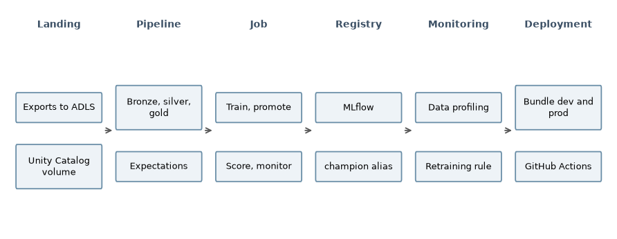

# Predictive Maintenance ML: Condition Monitoring for a Precision Machining Shop

## Summary

A condition-monitoring and predictive maintenance system for a 20-machine contract machining shop, built end to end on Azure Databricks. It combines:
- hourly vibration measurements from 20 wireless sensor points on the HMC cell and the plant compressors;
- controller data from every machine;
- maintenance history from the CMMS.

From these it scores vendor alert rules, per-point normal-behavior models and controller-based health models. It fuses them into one status per asset, opens cases, and raises work requests with a suspected condition.

Evaluated in shadow mode over April to June 2026:
- the model layer warned before 3 of 4 conditions on the instrumented assets, against 2 of 4 for the vendor rules;
- over July 2025 to June 2026, it caught 6 of 12 against 4 of 12, at a lower false-alert rate.

Included:
- the [maintenance queue](https://bmdvs.github.io/predictive-maintenance-ml/);
- a [model report](https://bmdvs.github.io/predictive-maintenance-ml/reports/model_report.html);
- a [monitoring report](https://bmdvs.github.io/predictive-maintenance-ml/reports/monitoring_report.html);
- the full pipeline, model and deployment code.


## Business Context

The shop machines precision parts in the northwest suburbs of Chicago on 20 CNC machines. Its four-machine HMC cell is the bottleneck. In July 2023 it installed wireless vibration sensors on the HMC cell and its two compressors, and through June 2026 it maintained them on the sensor vendor's threshold alerts and interval-based PM.

Spindle and pump failures on the HMC cell stop the shop's highest-margin work. Vendor alerts raised inspections that most often found nothing. The shop built a model layer on the three-year record to catch more developing faults earlier, at no more inspection workload, and evaluated it alongside the vendor alerts for a quarter before acting on it.

## Models and methods

- **Rule floor:** the vendor's baseline alerts and ISO 20816 zones.
- **Per-point normal-behavior models:** an autoencoder on one-third-octave vibration bands, selected from four candidates.
- **Controller health:** load drift and thermal residual models.
- **Fusion:** a case per asset.
- **Advisory:** rule-based diagnosis.
- **Survival:** fleet Weibull models for PM review.
- **Remaining time:** for pump and compressor bearings.
- **Evaluation:** event-based against confirmed conditions, with chance levels and false episodes per asset-month.
- **Model governance:** a monthly champion and challenger cycle with automated promotion gates.

## Data

- **The record:** three years, July 2023 to June 2026. It holds hourly sensor scalars, retained vibration bursts, controller minute aggregates and events, compressor controller data, CMMS work orders and PM records, ERP jobs and the asset register.
- **How it was generated:** from degradation and failure mechanisms published for rolling bearings, pumps, compressors and machine tools, including bearing defect signatures, four-stage degradation, lubrication loss, crash damage and coolant system faults. Realism checks test the published behavior.
- **Why:** the record is generated so the full workflow can be shared.

## Architecture

- **Platform:** Azure Databricks with Unity Catalog, organized as landing, bronze, silver, gold, ml and monitoring schemas.
- **Pipeline:** a Lakeflow Declarative Pipeline (Auto Loader ingest, materialized views, expectations).
- **Job:** a monthly Lakeflow Job: pipeline update, train, promote, score, monitor.
- **Models:** MLflow experiments and the Unity Catalog model registry, with a `champion` alias.
- **Monitoring:** Databricks data profiling.
- **Deployment:** `databricks bundle deploy -t prod` from a Declarative Automation Bundle with dev and prod targets, deployed through the shadow quarter by GitHub Actions as a service principal. GitHub Actions lints and tests every change.
- **Cost:** about $6 in Azure infrastructure through October 27, 2026, with Databricks usage covered by the trial allowance.



## How to run

- locally: the parity runner and the page build;
- on the platform: the bundle deploy and the job.


```bash
pip install -e ".[dev,spark]"
python -m pdm.parity
python -m pdm.reports.build
```

```bash
databricks bundle validate -t prod
databricks bundle deploy -t prod
databricks bundle run -t prod pdm_monthly --no-wait
```

**Author:** Brian Davis. Data engineering and applied analytics/ML for manufacturers.

**Link:** https://github.com/bmdvs
