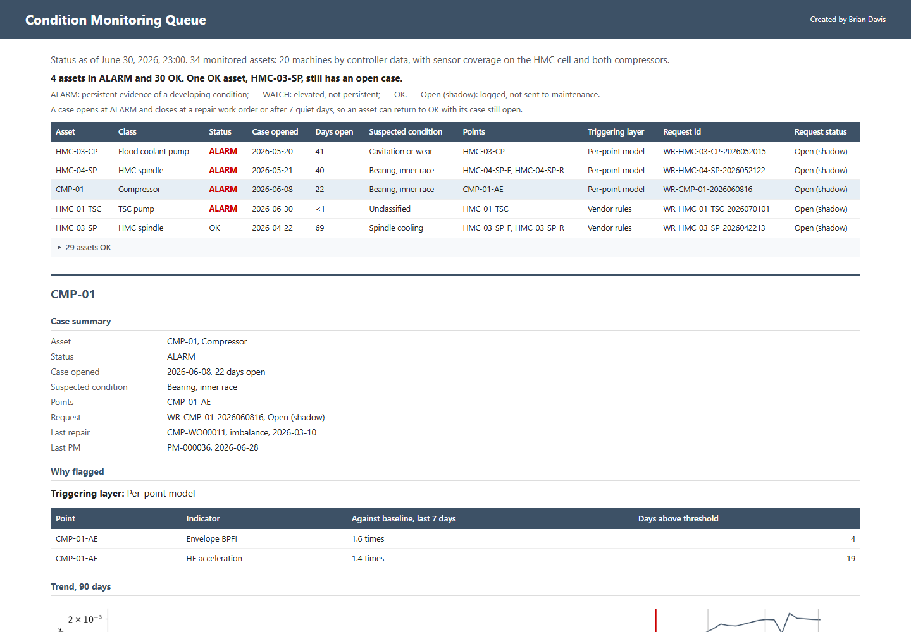
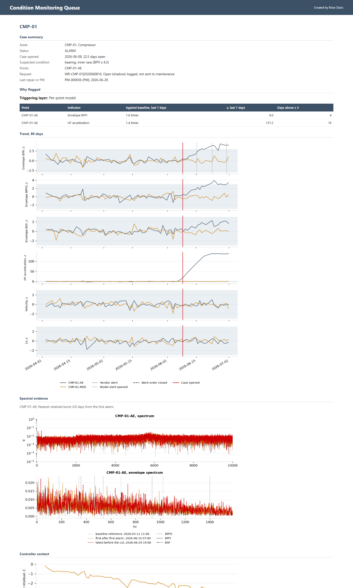
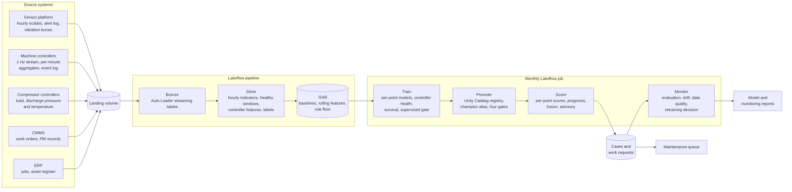

# Machine Learning Model: Predictive Maintenance

This project was built on Azure Databricks: a Lakeflow pipeline ingests and transforms raw exports from the shop's sensor platform, machine controllers, CMMS and ERP, and a monthly job trains, gates, scores and monitors the models through MLflow and the Unity Catalog model registry.

A **condition-monitoring and predictive maintenance model layer** was built on three years of the shop's records. Every hour it scores the 20 wireless vibration sensor points on the HMC cell and the plant compressors, along with controller data from all 20 machines. It combines the results into one status per asset and raises work requests with a suspected condition. The model code is in [`src/pdm/`](src/pdm/). The model is detailed in the [model report](https://bmdvs.github.io/predictive-maintenance-ml/reports/model_report.html) and summarized below.

- **Results.** The model layer ran in shadow mode alongside the vendor's alert rules from April to June 2026. The table compares the two over that quarter and over the evaluation year, July 2025 to June 2026. The model layer caught more conditions in both periods, with fewer false alerts over the year. Its additional catches were a coolant pump seal and impeller failure and an HMC spindle cooling fault; the vendor rules caught neither condition type in the year. The difference rests on two conditions, so it is consistent with the model layer's advantage but too small to establish it.

<div align="center">

<b>Model Layer vs. Vendor Alert Rules on the Instrumented Assets</b>

| | Caught, Apr to Jun 2026 | Caught, Jul 2025 to Jun 2026 | Median warning (year) | False episodes per asset-month (year) | Inspection hours on false alerts (year) |
|:---|:---:|:---:|:---:|:---:|:---:|
| Vendor alert rules | 2 of 4 | 4 of 12 | 31.8 days | 0.21 | 42.8 |
| **Model layer** | **3 of 4** | **6 of 12** | **34.8 days** | **0.19** | **38.1** |

</div>

- **Purpose and use.** Each hour, the model layer scores every sensor point on three layers: the vendor's alert rules, a normal-behavior model per point, and controller-based health models. It combines them into one status per asset (OK, WATCH or ALARM). At ALARM it opens a case and raises a work request with the suspected condition and a recommended inspection. The maintenance team is meant to use it in place of the vendor alerts: they review the queue, open each asset's detail panel and schedule the recommended inspection. A fleet survival model supports PM interval review. In the shadow quarter, requests were logged and not sent to maintenance.
- **Model training.** The models were trained on July 2023 to June 2025. July 2025 to March 2026 was used for validation, and the April to June 2026 shadow quarter was held out until the models were final. The record holds 64 confirmed conditions: 46 in training, 12 in validation and 6 in the shadow quarter.
  - Each sensor point's normal-behavior model is an autoencoder on 32 one-third-octave vibration bands. It is trained on the point's healthy hours and restarted after each repair and sensor remount, and it alerts above the 99.5th percentile of healthy scores held for six hours.
  - Controller health tracks per-program spindle and axis load drift, a spindle thermistor residual against speed and season, and a compressor discharge temperature residual.
  - Signals within 72 hours fuse into one case per asset.
  - A fleet Weibull model is fitted to 39 component lives, and a remaining-time model covers pump and compressor bearings.
- **Model evaluation.**
  - **Candidates.** Four candidates (autoencoder, Mahalanobis distance, PCA, isolation forest) were compared on the training period and selected by rule before validation. The autoencoder caught 47% of training conditions at 0.064 false episodes per asset-month.
  - **Detection.** Evaluation is event-based against confirmed conditions. At the vendor rules' false-alert rate for the year, the per-point models caught 58% of conditions, the model layer 50% and the vendor rules 33%, against about 20% by chance.
  - **Diagnosis.** Work requests named the confirmed cause for 3 of 7 conditions.
  - **Survival.** The fitted Weibull shape is 1.91 (90% interval 1.22 to 2.98), so failure rates rise with service time. Nine failures are too few to set intervals from.
  - **Remaining time.** None of the 9 remaining-time estimates came within 20% of the actual remaining life.
  - **Supervised layer.** No supervised classifier was trained: the training period holds 6 failures against a minimum of 8.
  - **Recommended change.** Through-spindle coolant pressure, measured while the pump runs, fell 5 to 10% ahead of each of the three rotary-union leaks. Moving the advisory to that series is the highest-value change identified.
  - Full evaluation and technical detail are in the model report's appendix.
- **Production monitoring.** The models are retrained monthly in a champion and challenger cycle. A challenger is promoted only if it passes four gates: the selection rule's pick, parity with training scores to 1e-9, every fitted segment present, and false episodes within twice the validation rate. Versions 5, 6 and 7 were promoted in April, May and June. A monitor tracks event recall and alert rates per method against retraining thresholds, feature and score drift, and data quality, alongside Databricks data profiling. Additional detail is in the [monitoring report](https://bmdvs.github.io/predictive-maintenance-ml/reports/monitoring_report.html).

The model layer's statuses, cases and work requests are presented in a [maintenance queue](https://bmdvs.github.io/predictive-maintenance-ml/), one row per monitored asset, with a detail panel per asset showing indicator trends, spectral evidence and history:

[](https://bmdvs.github.io/predictive-maintenance-ml/)
[](https://bmdvs.github.io/predictive-maintenance-ml/)

---

## Business Context

A contract machining shop in the northwest suburbs of Chicago machines precision parts on 20 CNC machines. Its four-machine HMC cell is the bottleneck. In July 2023 it installed wireless vibration sensors on the HMC cell and its two compressors. Through June 2026, it maintained them on the sensor vendor's threshold alerts and interval-based PM.

Spindle and pump failures on the HMC cell stop the shop's highest-margin work, and vendor alerts raised inspections that most often found nothing. The shop built a model layer on the three-year record to catch more developing faults earlier with no added inspection workload. It ran the model layer alongside the vendor alerts for a quarter before acting on it.

---

## Deliverables

| # | Deliverable | What it is | Links |
|---|---|---|---|
| 1 | Maintenance queue | One row per monitored asset with its status, open case and work request. Each asset's detail panel holds indicator trends against baseline, fault-band and spectral evidence from the latest vibration bursts, controller trends, and case and work order history. | [View](https://bmdvs.github.io/predictive-maintenance-ml/) |
| 2 | Model report | Detection and warning against the vendor rules, work requests and diagnosis, component life and remaining time, the model overview, and appendices on scoring layers, indicators, evaluation definitions, model selection, governance, validation results, platform and limitations. | [View](https://bmdvs.github.io/predictive-maintenance-ml/reports/model_report.html) |
| 3 | Monitoring report | Monthly monitoring of the shadow quarter against the retraining rule: event performance and alert rates by method, feature and score drift, data quality, model versions and post-repair baseline resets. | [View](https://bmdvs.github.io/predictive-maintenance-ml/reports/monitoring_report.html) |

---

## Code

### Data pipeline: [`databricks/pipeline/`](databricks/pipeline/) and [`src/pdm/ingest/`](src/pdm/ingest/), [`src/pdm/quality/`](src/pdm/quality/)

| Layer | What it is, does and contains |
|---|---|
| Bronze | One Auto Loader streaming table per source export table, loaded from the landing volume. |
| Silver | Measurement points, regime-tagged hourly indicators, healthy windows per point, controller features, confirmed-condition labels from the CMMS, and the data-quality views. |
| Gold | Baselines per healthy window and regime, the fleet baseline check, rolling features over 24 hours, 7 days and 30 days, and the rule floor. |
| Quality | Data-quality expectations per table, shared by the pipeline and the local parity run; implausible-row flags on the hourly sensor scalars; gap and measurement-state checks against the controller. |

### Signal processing and features: [`src/pdm/features/`](src/pdm/features/)

| File | What it does |
|---|---|
| `burst.py`, `filters.py` | Reduces each triaxial acceleration burst to scalar indicators: velocity, acceleration and high-frequency RMS, crest factor and kurtosis. |
| `envelope.py`, `kinematics.py` | Envelope analysis with spectral-kurtosis band selection, and bearing defect frequencies from register geometry. |
| `spectral.py` | Averaged spectrum, shaft-order band energies and one-third-octave band energies. |
| `indicators.py`, `rolling.py`, `baselines.py` | The hourly indicator table, rolling features and baseline statistics. |
| `windows.py` | Healthy windows per point from the register and CMMS. |
| `controller.py` | Controller features per machine, hour and program, and daily controller event counts. |

### Models and scoring: [`src/pdm/`](src/pdm/)

| File | What it does |
|---|---|
| `rules/` | The vendor's baseline alerts replayed from the sensor platform export, and the ISO 20816-3 zone rule, with persistence and suppression shared by every alerting layer. |
| `models/nbm.py`, `models/nbm_pyfunc.py` | Per-point normal-behavior models (autoencoder, Mahalanobis distance, PCA, isolation forest), one per segment of a point, and the MLflow wrapper for the registry. |
| `models/controller_health.py` | Spindle and axis load drift per program, the spindle thermistor residual and the compressor discharge temperature residual, for all 20 machines. |
| `fusion/status.py` | Asset status from all alerting layers, and the case log. |
| `advisory/requests.py` | Work requests at ALARM with a suspected condition from the indicator pattern. |
| `models/survival.py` | Fleet Weibull and Cox survival models of component lives, with left truncation. |
| `models/prognosis.py` | Remaining time for pump and compressor bearings, from first detection to the ISO zone D boundary. |
| `models/supervised.py` | Failure-within-horizon classifier for the rotating auxiliaries, trained only above the minimum failure count. |
| `evaluation/events.py` | Event-based evaluation against confirmed conditions, at matched false-alert budgets with chance levels. |

### Orchestration, governance and deployment

| File | What it does |
|---|---|
| [`databricks.yml`](databricks.yml), [`databricks/`](databricks/) | The Declarative Automation Bundle: dev and prod targets, the Lakeflow pipeline and the monthly job. |
| [`src/pdm/entrypoints.py`](src/pdm/entrypoints.py), [`src/pdm/tasks.py`](src/pdm/tasks.py) | The job's Python wheel tasks: train, promote, score and monitor. |
| `src/pdm/registry.py` | Champion and challenger promotion in the Unity Catalog model registry, with the four promotion gates. |
| `src/pdm/monitoring/performance.py` | Monthly event performance per method, feature and score drift, and the retraining decision. |
| `src/pdm/parity.py` | Runs the pipeline and every job task locally on the exports, checked against the workspace's tables. |
| [`databricks/scripts/`](databricks/scripts/) | Unity Catalog setup, landing the exports, service principal grants and the data profiles, as reproducible CLI scripts. |
| [`.github/workflows/ci.yml`](.github/workflows/ci.yml) | Lint and tests on every change, and bundle validation when workspace credentials are configured. |
| [`src/pdm/reports/`](src/pdm/reports/) | Builds the queue, both reports and this README from the gold snapshot in [`data/gold_snapshot/`](data/gold_snapshot/). |

---

## How it works



Raw exports from the sensor platform, machine controllers, compressor controllers, CMMS and ERP land in a Unity Catalog volume. A Lakeflow pipeline loads them into bronze tables and builds the silver and gold tables, with data-quality expectations on each. Along the way, each hourly vibration burst is reduced to condition indicators, and each point's healthy windows are set from the asset register and CMMS. The monthly job then:
- trains the challengers;
- promotes one to champion in the Unity Catalog registry when it passes its gates;
- scores every point from the champion and fuses the layers into cases and work requests;
- monitors performance, drift and data quality.

The pipeline and job are deployed from a Declarative Automation Bundle, and GitHub Actions lints and tests every change.

---

## Data

The datasets were generated to represent typical exports from a wireless vibration monitoring platform, CNC and compressor controllers, a CMMS and an ERP, so the full workflow can be shared publicly. The record covers July 2023 to June 2026 and holds:
- hourly sensor scalars and retained vibration bursts;
- controller minute aggregates and events;
- compressor controller data;
- CMMS work orders and PM records;
- ERP jobs and the asset register.

Conditions are built from published degradation and failure mechanisms for rolling bearings, pumps, compressors and machine tools: bearing defect signatures, four-stage degradation, lubrication loss, crash damage and coolant system faults. Realism checks test each against its published behavior. The generators are in [`generate/`](generate/) and the checks in [`generate/checks/`](generate/checks/).

---

## Running it locally

```bash
# 1. Environment
python -m venv .venv
source .venv/bin/activate          # Windows: .venv\Scripts\activate
pip install -e ".[dev,spark]"

# 2. Generate the source exports, run the realism checks and write the run report
python -m generate

# 3. The pipeline and every job task on the local exports
python -m pdm.parity

# 4. The queue, the reports and this README from the gold snapshot
python -m pdm.reports.build

# 5. Lint and tests
ruff check . && pytest
```

On the platform, from a configured Databricks CLI:

```bash
databricks bundle validate -t prod
databricks bundle deploy -t prod
databricks bundle run -t prod pdm_monthly --no-wait
```

The page build writes standalone HTML to [`docs/`](docs/), which GitHub Pages serves.

---

## Stack

| Layer | Tools |
|---|---|
| Platform | Azure Databricks, Unity Catalog, Azure Data Lake Storage Gen2 |
| Ingestion & transformation | Lakeflow Declarative Pipelines (Auto Loader, materialized views, expectations), PySpark, Delta Lake |
| Orchestration & deployment | Lakeflow Jobs (Python wheel tasks), Declarative Automation Bundles, GitHub Actions, service principal |
| Signal processing | NumPy, SciPy (filtering, envelope analysis, spectra) |
| Modeling | scikit-learn (autoencoder, PCA, isolation forest, Mahalanobis distance), lifelines, scikit-survival |
| Model tracking & registry | MLflow, Unity Catalog model registry |
| Monitoring | SciPy (Wasserstein distance), Databricks data profiling |
| Data generation | Python, NumPy, pandas |
| Reporting | matplotlib, HTML/CSS, GitHub Pages |

---

**Author:** Brian Davis. Data engineering and applied analytics/ML for manufacturers.

**Link:** https://github.com/bmdvs
