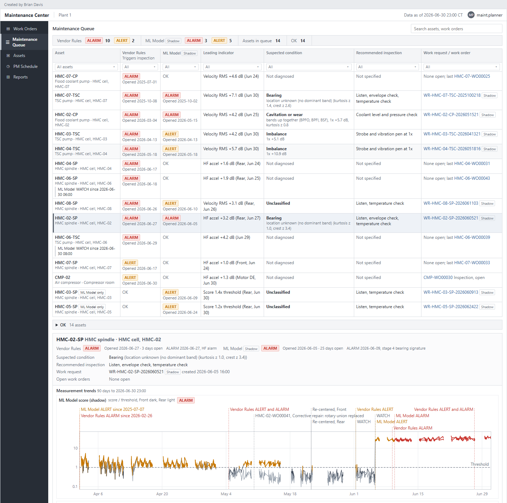
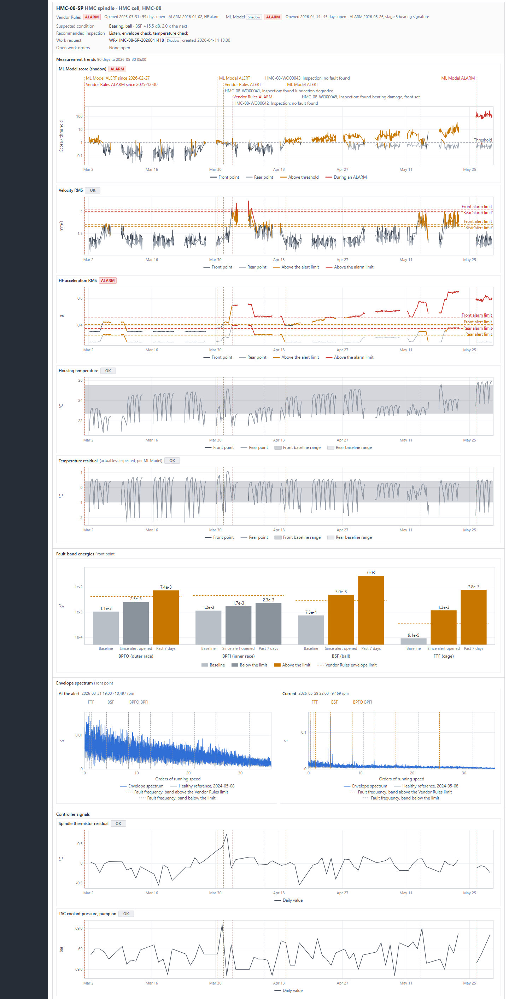
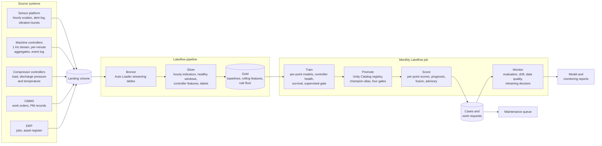

# Machine Learning Model: Predictive Maintenance

This project was built on Azure Databricks: a Lakeflow pipeline ingests and transforms raw exports from the shop's sensor platform, machine controllers, CMMS and ERP, and a monthly job trains, gates, scores and monitors the models through MLflow and the Unity Catalog model registry. All code related to data and ML engineering is found below in the Code section. 

A **Predictive Maintenance ML model** was built on the past three years of the shop's records. Every hour, it reads vibration and temperature measurements from 40 wireless sensor points on eight HMCs and four plant compressors. When readings depart from a sensor point’s normal behavior, the model raises an ALERT (inspection needed), escalating to an ALARM (urgent repair) when the condition becomes severe. The model code is found [here](src/pdm/). The model is detailed in the [model report](https://bmdvs.github.io/predictive-maintenance-ml/reports/model_report.html) and summarized below.

- **Results.** The table below compares the predictive maintenance model (ML Model) against the Vendor Rules method, which is the shop's existing condition monitoring layer. Vendor Rules applies fixed threshold alerts on sensor measurements: velocity, high-frequency acceleration and bearing fault bands, and its ALERTs and ALARMs drive maintenance requests. The ML Model ran in shadow mode beside Vendor Rules during the evaluation year (July 2025 to June 2026), with its ALERTs and ALARMs recorded and not acted on, in order to evaluate its performance.
  - Against [N] confirmed conditions, the ML Model caught [a] against the Vendor Rules' [b], with [x]% fewer false alerts and [y]% fewer false ALARMs.
  - [One sentence on warning time.]
  - [One sentence naming the conditions only one method caught.]

<div align="center">

<b>ML Model vs. Vendor Rules, July 2025 to June 2026</b>

| | Conditions caught | Median warning (days) | False ALERTs per asset-month | False ALARMs per asset-month | Inspection hours on false alerts |
|:---|:---:|:---:|:---:|:---:|:---:|
| Vendor Rules | [b] of [N] | [ ] days | [ ] | [ ] | [ ] |
| **ML Model** | **[a] of [N]** | **[ ] days** | **[ ]** | **[ ]** | **[ ]** |

</div>

- **Purpose and use.** Each hour, the ML Model scores every sensor point against its learned normal behavior. It raises an ALERT (inspection needed) or an ALARM (urgent repair) and opens a work request with the suspected condition and a recommended inspection. During the evaluation year, the Vendor Rules drove the maintenance queue and the ML Model's status was shown beside them. 
- **Model training.** The model was trained on July 2023 to June 2025 and selected on expanding-window folds within that period. The evaluation year, July 2025 to June 2026, was held out until the model was chosen. The record holds [N] confirmed conditions in scope: [n1] in training and [N] in the evaluation year.
  - An autoencoder (a neural network ML model) is trained for each sensor point and learns its normal behavior from the same 13 measurements Vendor Rules uses (velocity, high-frequency acceleration, envelope fault bands, shaft-order energies, crest factor, kurtosis and temperature), plus operating data from the machines' controllers.
  - The model is trained on the point's healthy hours and re-centered after each repair and sensor remount.
  - The model flags ALERTs above the 99.5th percentile of healthy scores, held for six hours. An open ALERT escalates to an ALARM when the asset also crosses a severity criterion for its class: velocity in the ISO danger zone, a late-stage bearing signature, a spindle or compressor temperature limit, or sustained pump cavitation.
- **Model evaluation.**
  - **Selection.** Four model types (autoencoder, Mahalanobis distance, PCA, isolation forest) were compared across five input sets and their settings on the training folds, and the best model (autoencoder) was selected.
  - **Detection.** Evaluation is event-based against confirmed conditions, with the same scope, crediting and false-alert definitions applied to both methods. [Headline catches, strict count, warning.]
  - **Diagnosis.** Work requests named the confirmed condition for [x] of [y] caught conditions.
  - **Recommended change.** [To confirm on the new record: TSC coolant pressure ahead of rotary-union leaks.]
  - Full evaluation and technical detail are in the [model report's](https://bmdvs.github.io/predictive-maintenance-ml/reports/model_report.html) appendix.
- **Production monitoring.** A monthly monitor tracks event recall, alert rates against the Vendor Rules, feature and score drift, and data quality, alongside Databricks data profiling. Model retraining is evaluated each month based on set rules, as detailed is in the [monitoring report](https://bmdvs.github.io/predictive-maintenance-ml/reports/monitoring_report.html).

The Vendor Rules' and ML Model's statuses and work requests are presented in a [maintenance queue](https://bmdvs.github.io/predictive-maintenance-ml/) in the shop's CMMS, one row per asset at ALERT or ALARM, with a detail section per asset showing measurement trends, fault-band energies, spectra and maintenance history:

[](https://bmdvs.github.io/predictive-maintenance-ml/)
[](https://bmdvs.github.io/predictive-maintenance-ml/)

---

## Business Context

A precision machining shop runs 40 CNC machines. Its eight horizontal machining centers (HMCs) are the bottleneck: they carry [share]% of the shop's cutting hours at [71]% utilization, and an hour of HMC downtime costs [value, USD] in contribution margin, [x] times the average for the rest of the fleet. Spindle and pump failures on the HMCs stop the shop's highest-margin work.

In July 2023 the shop began a pilot of sensor-based condition monitoring on the HMC cell and the compressors: wireless sensors on 40 points, monitored as 28 assets (each HMC's spindle, through-spindle coolant (TSC) pump and flood coolant pump, and each compressor). These sensors were monitored by the sensor vendor's threshold alerts, Vendor Rules, alongside interval-based PM. Vendor Rules alerts sent technicians to inspect machines at a [x] false alert rate, leading to [x] hours of inspections that found nothing wrong. 

To lower this false alert rate, and to catch developing faults earlier, this project built the ML Model on the sensor record and ran it in shadow mode beside Vendor Rules over the evaluation year to prove its effectiveness.

---

## Deliverables

| # | Deliverable | What it is | Links |
|---|---|---|---|
| 1 | Maintenance queue | One row per monitored asset with its status, open case and work request. Each asset's detail panel holds indicator trends against baseline, fault-band and spectral evidence from the latest vibration bursts, controller trends, and case and work order history. | [View](https://bmdvs.github.io/predictive-maintenance-ml/) |
| 2 | Model report | Detection and warning against the vendor rules, work requests and diagnosis, component life and remaining time, the model overview, and appendices on scoring layers, indicators, evaluation definitions, model selection, governance, validation results, platform and limitations. | [View](https://bmdvs.github.io/predictive-maintenance-ml/reports/model_report.html) |
| 3 | Monitoring report | Monthly monitoring of the shadow quarter against the retraining rule: event performance and alert rates by method, feature and score drift, data quality, model versions and post-repair baseline resets. | [View](https://bmdvs.github.io/predictive-maintenance-ml/reports/monitoring_report.html) |

---

## Code

### Data pipeline: [`databricks/pipeline/`](databricks/pipeline/) and [`src/pdm/ingest/`](src/pdm/ingest/), [`src/pdm/quality/`](src/pdm/quality/)

| Layer | What it is, does and contains |
|---|---|
| Bronze | One Auto Loader streaming table per source export table, loaded from the landing volume. |
| Silver | Measurement points, regime-tagged hourly indicators, healthy windows per point, controller features, confirmed-condition labels from the CMMS, and the data-quality views. |
| Gold | Baselines per healthy window and regime, the fleet baseline check, rolling features over 24 hours, 7 days and 30 days, and the rule floor. |
| Quality | Data-quality expectations per table, shared by the pipeline and the local parity run; implausible-row flags on the hourly sensor scalars; gap and measurement-state checks against the controller. |

### Signal processing and features: [`src/pdm/features/`](src/pdm/features/)

| File | What it does |
|---|---|
| `burst.py`, `filters.py` | Reduces each triaxial acceleration burst to scalar indicators: velocity, acceleration and high-frequency RMS, crest factor and kurtosis. |
| `envelope.py`, `kinematics.py` | Envelope analysis with spectral-kurtosis band selection, and bearing defect frequencies from register geometry. |
| `spectral.py` | Averaged spectrum, shaft-order band energies and one-third-octave band energies. |
| `indicators.py`, `rolling.py`, `baselines.py` | The hourly indicator table, rolling features and baseline statistics. |
| `windows.py` | Healthy windows per point from the register and CMMS. |
| `controller.py` | Controller features per machine, hour and program, and daily controller event counts. |

### Models and scoring: [`src/pdm/`](src/pdm/)

| File | What it does |
|---|---|
| `rules/` | The vendor's baseline alerts replayed from the sensor platform export, and the ISO 20816-3 zone rule, with persistence and suppression shared by every alerting layer. |
| `models/nbm.py`, `models/nbm_pyfunc.py` | Per-point normal-behavior models (autoencoder, Mahalanobis distance, PCA, isolation forest), one per segment of a point, and the MLflow wrapper for the registry. |
| `models/controller_health.py` | Spindle and axis load drift per program, the spindle thermistor residual and the compressor discharge temperature residual, for all 20 machines. |
| `fusion/status.py` | Asset status from all alerting layers, and the case log. |
| `advisory/requests.py` | Work requests at ALARM with a suspected condition from the indicator pattern. |
| `models/survival.py` | Fleet Weibull and Cox survival models of component lives, with left truncation. |
| `models/prognosis.py` | Remaining time for pump and compressor bearings, from first detection to the ISO zone D boundary. |
| `models/supervised.py` | Failure-within-horizon classifier for the rotating auxiliaries, trained only above the minimum failure count. |
| `evaluation/events.py` | Event-based evaluation against confirmed conditions, at matched false-alert budgets with chance levels. |

### Orchestration, governance and deployment

| File | What it does |
|---|---|
| [`databricks.yml`](databricks.yml), [`databricks/`](databricks/) | The Declarative Automation Bundle: dev and prod targets, the Lakeflow pipeline and the monthly job. |
| [`src/pdm/entrypoints.py`](src/pdm/entrypoints.py), [`src/pdm/tasks.py`](src/pdm/tasks.py) | The job's Python wheel tasks: train, promote, score and monitor. |
| `src/pdm/registry.py` | Champion and challenger promotion in the Unity Catalog model registry, with the four promotion gates. |
| `src/pdm/monitoring/performance.py` | Monthly event performance per method, feature and score drift, and the retraining decision. |
| `src/pdm/parity.py` | Runs the pipeline and every job task locally on the exports, checked against the workspace's tables. |
| [`databricks/scripts/`](databricks/scripts/) | Unity Catalog setup, landing the exports, service principal grants and the data profiles, as reproducible CLI scripts. |
| [`.github/workflows/ci.yml`](.github/workflows/ci.yml) | Lint and tests on every change, and bundle validation when workspace credentials are configured. |
| [`src/pdm/reports/`](src/pdm/reports/) | Builds the queue, both reports and this README from the gold snapshot in [`data/gold_snapshot/`](data/gold_snapshot/). |

---

## How it works



Raw exports from the sensor platform, machine controllers, compressor controllers, CMMS and ERP land in a Unity Catalog volume. A Lakeflow pipeline loads them into bronze tables and builds the silver and gold tables, with data-quality expectations on each. Along the way, each hourly vibration burst is reduced to condition indicators, and each point's healthy windows are set from the asset register and CMMS. The monthly job then:
- trains the challengers;
- promotes one to champion in the Unity Catalog registry when it passes its gates;
- scores every point from the champion and fuses the layers into cases and work requests;
- monitors performance, drift and data quality.

The pipeline and job are deployed from a Declarative Automation Bundle, and GitHub Actions lints and tests every change.

---

## Data

The datasets were generated to represent typical exports from a wireless vibration monitoring platform, CNC and compressor controllers, a CMMS and an ERP, so the full workflow can be shared publicly. The record covers July 2023 to June 2026 and holds:
- hourly sensor scalars and retained vibration bursts;
- controller minute aggregates and events;
- compressor controller data;
- CMMS work orders and PM records;
- ERP jobs and the asset register.

Conditions are built from published degradation and failure mechanisms for rolling bearings, pumps, compressors and machine tools: bearing defect signatures, four-stage degradation, lubrication loss, crash damage and coolant system faults. Realism checks test each against its published behavior. The generators are in [`generate/`](generate/) and the checks in [`generate/checks/`](generate/checks/).

---

## Running it locally

```bash
# 1. Environment
python -m venv .venv
source .venv/bin/activate          # Windows: .venv\Scripts\activate
pip install -e ".[dev,spark]"

# 2. Generate the source exports, run the realism checks and write the run report
python -m generate

# 3. The pipeline and every job task on the local exports
python -m pdm.parity

# 4. The queue, the reports and this README from the gold snapshot
python -m pdm.reports.build

# 5. Lint and tests
ruff check . && pytest
```

On the platform, from a configured Databricks CLI:

```bash
databricks bundle validate -t prod
databricks bundle deploy -t prod
databricks bundle run -t prod pdm_monthly --no-wait
```

The page build writes standalone HTML to [`docs/`](docs/), which GitHub Pages serves.

---

## Stack

| Layer | Tools |
|---|---|
| Platform | Azure Databricks, Unity Catalog, Azure Data Lake Storage Gen2 |
| Ingestion & transformation | Lakeflow Declarative Pipelines (Auto Loader, materialized views, expectations), PySpark, Delta Lake |
| Orchestration & deployment | Lakeflow Jobs (Python wheel tasks), Declarative Automation Bundles, GitHub Actions, service principal |
| Signal processing | NumPy, SciPy (filtering, envelope analysis, spectra) |
| Modeling | scikit-learn (autoencoder, PCA, isolation forest, Mahalanobis distance), lifelines, scikit-survival |
| Model tracking & registry | MLflow, Unity Catalog model registry |
| Monitoring | SciPy (Wasserstein distance), Databricks data profiling |
| Data generation | Python, NumPy, pandas |
| Reporting | matplotlib, HTML/CSS, GitHub Pages |

---

**Author:** Brian Davis. Data engineering and applied analytics/ML for manufacturers.

**Link:** https://github.com/bmdvs
